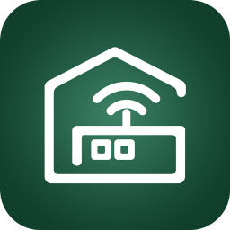
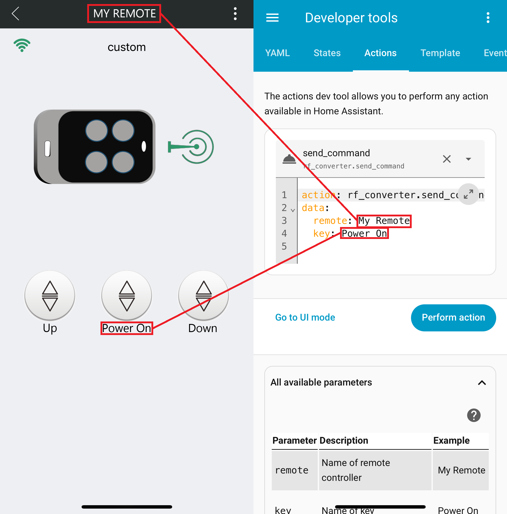

# RF Converter Assistant

The `RF Converter Assistant` is a custom component for Home Assistant that enables direct communication with the **RF Converter V3.0** to control devices using RF signals.

[Product Homepage](https://www.yetremotecontrol.com/products-detail-165885)

-----

## Installation

**Prerequisite**: Download the `Safemate` app (the vendor's official app) on a mobile device and sign up. Add a remote controller and keys as instructed by the vendor.

### 1\. Installation via HACS (Recommended)

1.  **Add Custom Repository**: In Home Assistant, go to **HACS** \> **Integrations**. Click the three-dot menu in the top right and select **Custom repositories**.
2.  **Enter Repository Details**: In the pop-up, enter `https://github.com/3735943886/rf_converter` as the **Repository URL**. For the **Category**, select **Integration**. Then, click **Add**.
3.  **Install the Integration**: Search for "**RF Converter Assistant**" in the HACS Integrations section. Click on it and then click the **Download** button.
4.  **Restart Home Assistant**: Restart the Home Assistant instance to complete the installation.

### 2\. Manual Installation

1.  **Download**: Clone the Git master branch or download it as a ZIP file.
2.  **Copy Files**: Copy the `rf_converter` directory to Home Assistant's `custom_components` directory.
3.  **Restart Home Assistant**: Restart the Home Assistant instance to complete the installation.

-----

## Component Configuration

1.  Add the `RF Converter Assistant` integration in Home Assistant.
2.  When prompted, enter the username found in the `Safemate` app.

-----

## Security and Data Transmission

Please read this section before installing.

- **Plaintext HTTP**: When remote controller data is loaded (on first setup and when the `reload_remote` action is called), the integration sends your Safemate account name and a fixed request code to the vendor's server at `http://47.254.152.213/`. This request uses plain HTTP, so the data is **not encrypted** and can be read by anyone on the network path.
- **Vendor app behavior**: The official Safemate app also transmits data in plaintext, as observed by the maintainer. This integration follows the same communication method as the vendor app.
- **Fixed request code**: The request code used in this integration is the same value that the official Safemate app sends with its requests. It is shared across all installations, is not a per-user credential, and is not an official API key. It is not a hidden value.
- **Vendor server dependency**: Remote controller data is retrieved from the vendor's cloud server. If the server is unavailable, the initial setup and the `reload_remote` action will fail. Once the data has been saved locally (in Home Assistant's `.storage` directory), commands are sent directly to the RF Converter over the local network (UDP port 26258) and do not require the vendor server.

Use this integration at your own discretion, on a network you trust.

-----

## Usage

Once installed, the following actions will be available. No devices or entities are created by this integration.

  - **RF Converter Assistant: reload\_remote**: This action obtains remote controller data from the vendor's cloud server and saves it locally. It's automatically called during the first run. Use this manually to update local data if any changes are made to remotes in the `Safemate` app.

  - **RF Converter Assistant: send\_command**: This action sends an RF signal from the RF Converter V3.0 to a target device. The `remote` and `key` parameters must be provided, which must exactly match the names used in the `Safemate` app.

> **Note**: The RF Converter's IP address is taken from the saved remote controller data. If the converter's IP address changes (e.g. a new DHCP lease), call `reload_remote` to update it.

### Example YAML

To call the `Power On` key of a remote named `My Remote`, use the following YAML code:

```yaml
action: rf_converter.send_command
data:
  remote: My Remote
  key: Power On
```


